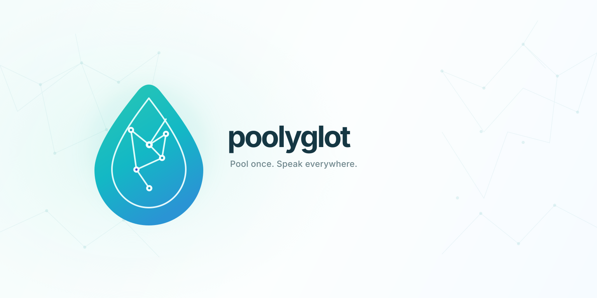
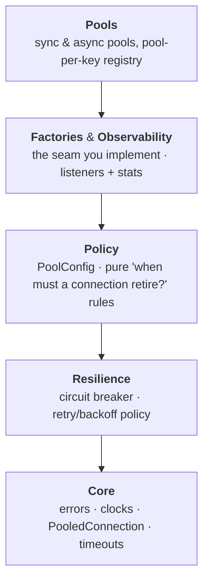
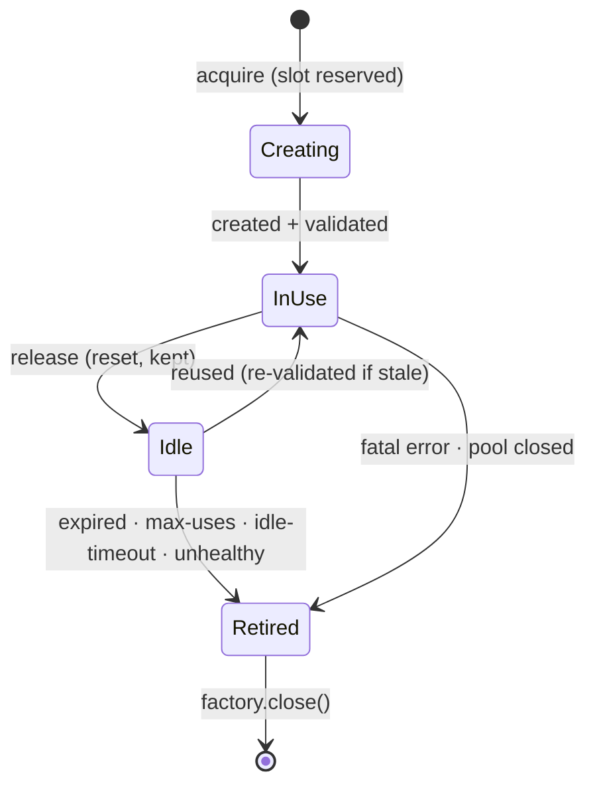
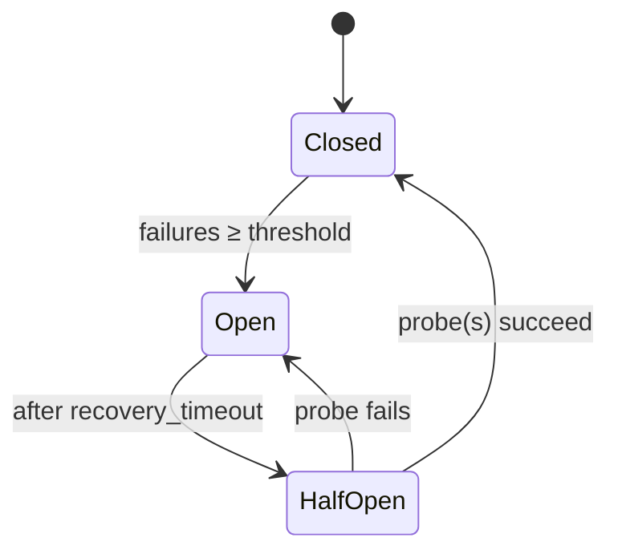

# poolyglot



A battle-tested connection-pool model — slot-reserved sizing, health & rotation rules, a circuit
breaker, backoff retries, and first-class observability — implemented *per language* and kept
API-parallel, so switching stacks is a syntax change, not a rewrite.

[](https://github.com/Jeffeek/poolyglot/actions/workflows/python.yml)
[](https://github.com/Jeffeek/poolyglot/actions/workflows/dotnet.yml)
[](https://app.codecov.io/gh/Jeffeek/poolyglot)
[](LICENSE)

---

Pools **anything** a small user-supplied factory can `create`, `validate`, `reset` and `close` —
DB drivers, HTTP sessions, SSH clients, raw sockets. The pool knows nothing about your connection
except what the factory tells it.

## Why poolyglot

- **Pools anything** — one tiny factory interface; the pool stays backend-agnostic.
- **Identical across languages** — same field names, event names, defaults, and wire values. Learn it once.
- **Sync *and* async** — thread-based and `async`/`await` twins of the same model, in every language.
- **Resilient by default** — backoff retries + a circuit breaker that counts *one failure per logical creation*.
- **Observable** — listener hooks plus a stats snapshot with acquire-wait / create-latency percentiles.
- **Zero runtime dependencies** — standard library only (`connpool` ⇒ stdlib, `ConnPool` ⇒ `netstandard2.1`).
- **100% test coverage** — line *and* branch, enforced in CI for every language.

## Languages

| Language | Runtime | Status | Package | Coverage | Source |
| --- | --- | :---: | --- | --- | --- |
| **Python** | sync + `asyncio` | ✅ stable | [](https://pypi.org/project/connpool/) | [](https://app.codecov.io/gh/Jeffeek/poolyglot?flags%5B0%5D=python) | [`python/`](python/) |
| **C# / .NET** | sync + `async` | ✅ stable | [](https://www.nuget.org/packages/ConnPool/) | [](https://app.codecov.io/gh/Jeffeek/poolyglot?flags%5B0%5D=csharp) | [`csharp/`](csharp/) |
| Java | — | 🚧 planned | — | — | `java/` |
| Go | — | 🚧 planned | — | — | `go/` |
| Rust | — | 🚧 planned | — | — | `rust/` |
| TypeScript (Node) | — | 🚧 planned | — | — | `typescript/` |

Each language lives in its own top-level directory with its own build and tests, but shares one
`VERSION`, one CHANGELOG per language, and the common behavior spec. CI runs a per-language workflow
scoped to that directory (see [`.github/workflows/`](.github/workflows/)).

## Quick start

### Python — `pip install connpool`

```python
from connpool import ConnectionPool, PoolConfig

pool = ConnectionPool.from_callables(
    make_conn, validate=is_alive,
    config=PoolConfig(max_size=20),
)
with pool:                        # warm-up + sweeper
    with pool.connection() as c:  # acquire→use→release
        c.do_something()
```

### C# — `dotnet add package ConnPool`

```csharp
using ConnPool;

var pool = ConnectionPool<MyConn>.FromCallables(
    MakeConn, validate: IsAlive,
    config: new PoolConfig { MaxSize = 20 });

using (pool)                      // warm-up + sweeper
{
    pool.Open();
    pool.Use(c => c.DoSomething());  // acquire→use→release
}
```

Full per-language docs: **[Python →](python/README.md)** · **[C# / .NET →](csharp/README.md)**

## Shared model

Every implementation targets the same contract:

| Area | Behavior |
| --- | --- |
| **Sizing** | `min_size` kept warm, `max_size` a hard cap (a slot is reserved *before* a connection is created). |
| **Rotation / health** | max lifetime (jittered), max uses, idle eviction, validate-on-checkout, optional background idle checks. |
| **Resilience** | exponential-backoff retries + a circuit breaker (one failure per *logical* creation, not per attempt). |
| **Backpressure** | cap the blocked-caller queue; excess callers fail fast. |
| **Observability** | listener hooks + a stats snapshot (counters + acquire-wait / create-latency percentiles). |
| **Shutdown** | idempotent close, graceful drain, no leaked slots on cancellation. |

> Field names, event names, and defaults are **identical** across languages — switching is a syntax
> change, not a mental-model change.

## Architecture

The library is layered with a strict **downward-only** dependency direction — each layer may only
use the ones below it. The same shape holds in every language (`core → resilience → policy →
factories/observability → pools`).



### Connection lifecycle



### Circuit breaker

Guards connection *creation*: once creations keep failing it trips **open** and fails fast, then
probes for recovery. A create failure (or a slow-backend create-timeout) counts; caller impatience
(acquire-timeout) or mid-create cancellation does not.



## Quality bar

- **100% line + branch coverage**, gated in CI for each language (`run_tests.sh`).
- Sync and async are **parallel implementations** of one model, with mirrored test suites.
- Releases are cut from the root `VERSION` and published via **trusted publishing** (OIDC, no stored
  keys) to PyPI and NuGet, with built artifacts attached to each GitHub Release.

## Contributing

Work happens inside the relevant language directory. A behavioral change to one language almost
always needs the mirror change in the others (and in the "Shared model" section above) — keeping the
implementations in lock-step is the whole point. See [`CLAUDE.md`](CLAUDE.md) for the repo contract.

## License

MIT — see [LICENSE](LICENSE).
