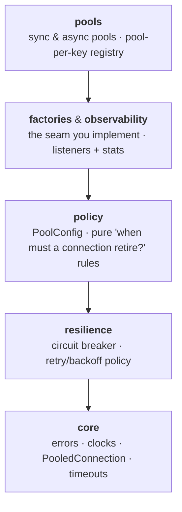
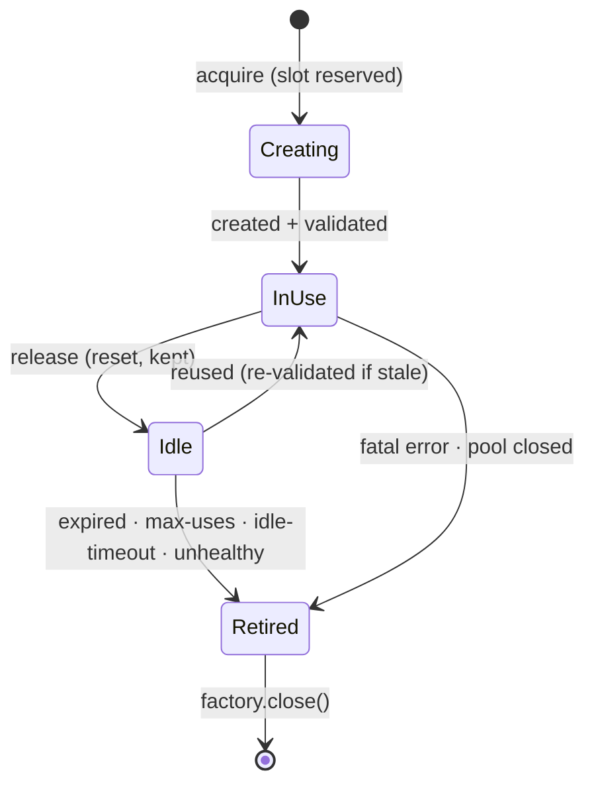
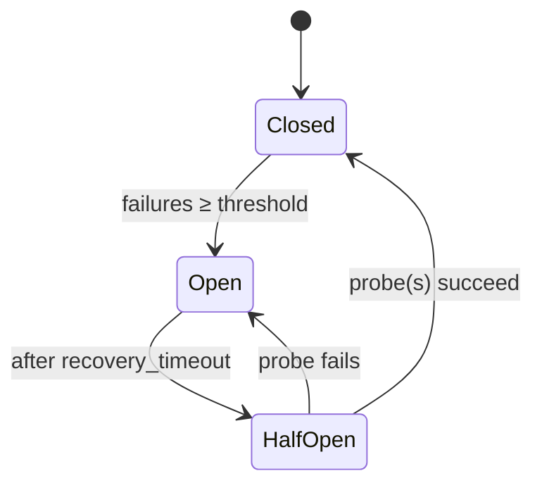

# Architecture

The single source of truth for poolyglot's internal shape. Every language implements this same
model, so the diagrams below are language-neutral; names are shown generically (Python uses
`snake_case`, C# uses `PascalCase`, but the structure is identical).

## Layering

The library is split into layers with a strict **downward-only** dependency direction — a layer may
only use the ones below it. Keeping the rules in the lower layers (and the I/O in the top one) is what
lets the sync and async pools stay parallel implementations of one model.

`core → resilience → policy → factories/observability → pools`. Pushing an import upward (e.g. `core`
importing from `pools`) is a design regression, not a quick fix.

## Connection lifecycle

What happens to a single connection from acquire to close.

## Circuit breaker

The breaker guards connection *creation*: once creations keep failing it trips **open** and fails
fast, then probes for recovery. A create failure (or a slow-backend create-timeout) counts as a
failure; caller impatience (acquire-timeout) or mid-create cancellation does **not** — it records an
abort instead, so an impatient caller can't trip the breaker.

It counts **one failure per logical creation** (a whole retry sequence), not per attempt.

---

For language-specific detail (exact names, defaults, APIs) see each implementation's README:
[Python](https://github.com/Jeffeek/poolyglot/blob/main/python/README.md) · [C# / .NET](https://github.com/Jeffeek/poolyglot/blob/main/csharp/README.md).
